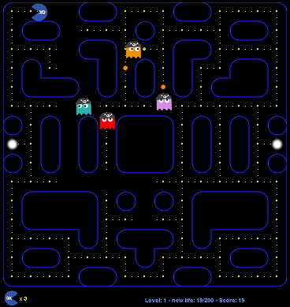
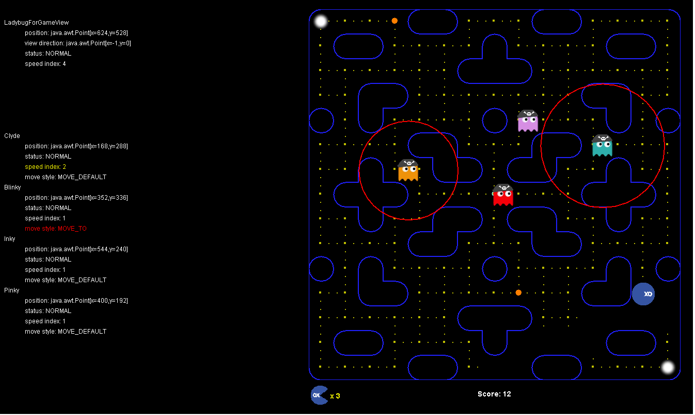

# Ladybug, "encore" un autre Pacman.
J'ai réalisé le programme "Ladybug" dans une optique de créer une application Java pour ré-apprendre et connaitre mieux Java en m'amusant.

J'ai essayé d'appliquer quelques trucs de programmation sympas : le motif d'architecture MVC, le framework Spring, l'utilisation des designs patterns, la hiérarchie des classes, le polymorphisme, les threads....

# C'est quoi le but du jeu ?

Vous êtes Ladybug, une cousine bien lointaine de Pacman, et vous n'avez qu'un seul but dans la vie : manger des gommes. Vous avez faim de gommes. Pour cela, vous avez mis votre OX-Tshirt bleu préféré, qui vous donne la force et l'envie d'avancer dans les niveaux.

Bien sûr, la vie serait bien trop simple, et peut être ennuyante, si vous étiez seule dans votre monde à déguster paisiblement les gommes : des fantômes rodent sur votre parcours, et malheureusement, leur contact peut être mortel. 



Heureusement, si un fantôme assez futé vous touche, vous avez la chance et la capacité de vous régénérer à votre point de départ du niveau. Dès le lancement de votre partie, le destin vous donne la possibilité de commettre 3 erreurs. Au fur et à mesure de votre expérience et de votre appétit, vous allez pouvoir augmenter le nombre d'erreurs possibles : votre XP augmente, votre nombre de vos vies aussi.

Vous finirez chaque niveau lorsque vous aurez mangé l'ensemble des gommes et des méga-gommes, peu importe le nombre de fruits restants. Regardez bien partout dans le niveau. 

Astuce : il se peut qu'il y ait des gommes plus ou moins cachées, notamment sur les points de téléportation ^^.

## Les fantômes
Les fantômes sont rancuniers ; ils se souviennent de leurs trop nombreuses expériences, souvent agaçantes, avec Pacman. Leur unique but est de vous empêcher, vous, Ladybug, la cousine lointaine de Pacman, de manger les gommes.

La nature étant imparfaite, les fantômes ont plus ou moins un tempérament intelligent, agressif voire négligeant ; ils ont aussi des facultés de déplacement plus ou moins rapide et progressif à chaque niveau.

| Hey ! Photo  | Description                                                                                                                                                                                                                                                                                             |
| ------------- |---------------------------------------------------------------------------------------------------------------------------------------------------------------------------------------------------------------------------------------------------------------------------------------------------------|
|  | Blinky, le fantôme rouge est celui que vous devriez vous méfier le plus. Plus votre niveau est élevé, plus il est agressif et vous pourchasse. <br/>De plus, plus vous mangez de gommes dans le niveau, plus il s'énerve et il se déplace de plus en plus vite.                                         |
|  | Inky, le fantôme vert-bleu, lui est bien différent. Le destin lui a apporté un comportement négligeant ; il mène son parcours comme bon lui semble, sans prendre en compte le monde extérieur. <br/>Tout en étant tranquille, son chemin peut être surprenant. surtout lorsque Ladybug s'approche trop. |
|  | Pinky, avec sa tenue rose, est du genre futée. Plus votre niveau est important, plus elle aura tendance à aller à votre rencontre, devant vous, et peut être vous prendre en tenaille avec Blinky.                                                                                                      |
|  | Clyde, le fantôme orange, est plutôt du genre pépère, comme Inky. Il se réveillera rien qu'à l'approche de Ladybug....                                                                                                                                                                                 |

Évidemment, plus vous montez dans les niveaux, plus leurs comportements personnel se dévoilent et leurs rapidités de déplacement accroissent.

## Allez, on joue !
Lorsqu'un niveau débute, vous, Ladybug, êtes assez loin de fantômes. 

Ils débutent tous regroupés sur un point précis : , leur point de départ qui est aussi leur point de regénération. 
Vous pouvez alors commencer tranquillement à vous régaler des gommes qui sont tout autour de vous. Mais attention, les fantômes arrivent vite !!

Pour vous défendre, vous avez une arme forte : la méga-gomme . Il y en a quelques-unes par niveau. 

Lorsque vous mangez une méga-gomme, vous obtenez, pendant un laps de temps le pouvoir de manger l'enveloppe "corporelle" des fantômes. Les fantômes deviennent alors ultras stressés d'être absorbés ; tellement stressés qu'il en change de couleur, qu'ils essaient de s'éloigner de vous. Leur stress est tellement important qu'il en est affaiblissant : leur vitesse alors diminue. 

Si vous n'arrivez pas à les manger, petit à petit, ils se calment et regagnent confiance. Leurs états "initial" et "stressé" alternent, et c'est pour ça qu'ils se mettent à clignoter, avant de reprendre leur comportement et leur vitesse de déplacement initiaux. Quand ils sont redevenus "normaux", les effets de la méga-gomme ont disparu.

Voici un fantôme stressé : 

Lorsque les fantômes sont dans cet état de stress avancé, même s'ils clignotent, vous pouvez manger leur enveloppe "corporelle". Après avoir été croqués, ils deviennent alors totalement inoffensifs et se dirigent instinctivement vers leur point de regénération dans le but de récupérer leur état initial et leur instinct envers vous.

## Les élements importants du jeu

Pour vous aider dans votre quête de gommes, voici les principaux éléments graphiques du jeu

| | Description |
|-----|--------|
|| Gomme à manger. L'ensemble des gommes de chaque niveau est votre quête |
|| Méga gomme : idéal pour stresser les fantômes |
|| Point de téléportation : il vous mènera automatiquement à un autre point de téléportation. Attention, ces points de téléportation sont également utilisés par les fantômes |
|| Point de départ des fantômes en début de niveau. Il sert aussi aux fantômes de point de regénération pour leur restituer leur état initial après que vous les ayez mangés |
|| Les fruits apparaissent durant chaque niveau. Ils vous servent à augmenter votre expérience, et donc, à vous faciliter à récupérer de nouvelles vies|

## Les commandes du clavier

Voici les commandes du clavier que vous utiliserez 

| Touches du clavier | Description                                                      |
|--------------------|------------------------------------------------------------------|
| Les flèches        | Permet à Ladybug de changer de direction                         |
| Z Q S D            | Permet au fantôme de changer de direction (en mode deux joueurs) |
| 1 ou 2             | Définition du mode du jeu : 1 ou 2 joueurs - avant la partie     |
| S                  | Lancer la partie (écran de présentation)                         |
| F1                 | Affichage de l'aide                                              |
| F2                 | Gestion du son (modes on/off)                                    |
| F3                 | Retirer/ afficher le logo du TShirt de Ladybug                   |
| F4                 | Porter / enlever le bandeau des fantômes                         |
| F5                 | Porter / enlever le chapeau des fantômes                         |
| F6                 | Gestion du mode "lampe allumée" (modes on/off) lors du jeu       |
| F7                 | Camouflage des fantômes (modes on/off)                           |
| P ou Pause         | Mise en pause / Reprise du niveau (P : pour les claviers Mac)    |
| ESC                | Fin du niveau ou Sortie du jeu                                   |
| Enter              | Passage du jeu en mode "debug"                                    |

Je vous laisse le plaisir de deviner les boutons de la manette XboxOne associés à ces actions.

Astuce : si vous utilisez une manette XboxOne, veuillez la brancher en USB. Vous pouvez brancher deux manettes XboxOne et les utiliser en mode deux joueurs.

# Quelques mots sur le projet en tant que tel

## Les branches sous GitHub
Dans GitHub, le projet Ladybug possède deux branches : une branche **master** et une branche **develop**

La branche **master** est en théorie la branche qui contient les versions (releases) taguées.

La branche **develop** est la branche en développement ; en bref, elle contient la prochaine version en mode draft : le développement en cours, et potentiellement aussi, quelques nouveaux bugs restant à corriger.

Depuis novembre 2026, **develop** est la branche par défaut du dépôt : les PR y arrivent, et les tests de mutation (PIT) y tournent chaque nuit.

## Builder et exécuter Ladybug
Le build de ladybug est réalisé par "maven" par la commande "mvn clean package" (ou "mvn clean verify" pour lancer aussi les tests).

En résumé, le build génère un fat jar Spring Boot : un jar qui contient toutes les dépendances décrites dans le fichier "pom.xml".

À ce jour (19 novembre 2026), le projet utilise **Java 21**, **Spring Boot 3.5** et Maven 3.9 (les dépendances viennent de Maven Central, réglage dans `.mvn/`).

La commande pour lancer le jeu est :

**java -jar target/ladybug-0.8.0-SNAPSHOT.jar**

Le jeu s'ouvre sur l'écran où se trouve la souris.

## Personnaliser le jeu

Tout se règle **sans recompiler**, en posant des fichiers à côté du jeu. Ladybug suit la convention de Spring Boot : un fichier posé dans le **dossier d'où l'on lance le jeu**, ou dans son sous-dossier `config/`, remplace celui du jar (`config/` passe en premier). Au démarrage, les logs indiquent les fichiers réellement utilisés :

```
Launch mode: LOCAL
Spring XML configuration: file:/Users/moi/ladybug/application-context.xml
Game properties: /Users/moi/ladybug/ladybug.properties (external, overrides the jar)
```

### Les fantômes : `application-context.xml`

Ce fichier Spring décrit les fantômes : leur classe, leur couleur, leur comportement (`CALM`, `AGGRESSIVE`, `SMART`), leur vitesse et la liste du groupe (`GroupGhost`). Pour le modifier, récupérez celui du jar, puis lancez le jeu depuis le même dossier :

```
unzip -p target/ladybug-0.8.0-SNAPSHOT.jar BOOT-INF/classes/application-context.xml > application-context.xml
java -jar target/ladybug-0.8.0-SNAPSHOT.jar
```

Exemple : retirer `<ref bean="Clyde" />` de la liste `GroupGhost` pour jouer contre trois fantômes. Pour utiliser un fichier placé ailleurs : `--ladybug.config=file:/chemin/vers/mon-context.xml`.

Si le fichier contient une erreur (classe mal écrite, fantôme mal câblé), le jeu l'explique dans une fenêtre et dans les logs, puis s'arrête : il ne revient pas en silence à la configuration du jar.

### L'apparence : `ladybug.properties`

| Propriété | Valeurs | Effet |
|---|---|---|
| `ghosts.hat` | `1` / `0` | chapeau des fantômes |
| `ghosts.headband` | `1` / `0` | bandeau des fantômes |
| `ladybug.skin` | `1` / `0` | peau de Ladybug |

Seules les propriétés à changer sont nécessaires, par exemple un fichier qui ne contient que `ghosts.hat=0`.

### Le reste : `application.properties` et options de lancement

Un `application.properties` posé à côté du jeu accepte tous les réglages de Spring Boot (par exemple le format des logs : `logging.pattern.console`).

| Option | Rôle |
|---|---|
| `--ladybug.config=file:…` | impose un fichier `application-context.xml` |
| `--ladybug.mode=LOCAL` | mode de lancement (seul mode pour l'instant ; héberger et rejoindre une partie viendront plus tard) |
| `-Dladybug.seed=123` (avant `-jar`) | rejoue le même hasard : la graine est écrite dans les logs à chaque partie |
| `-Dladybug.loop.autostart=false` (avant `-jar`) | pour les tests : la boucle du jeu ne démarre pas seule |

Pour en savoir plus : [doc/patterns/configuration-externalisee.md](doc/patterns/configuration-externalisee.md).

## Publier une version
Une version se publie depuis GitHub, sans rien installer : onglet **Actions**, workflow **Maven Release**, bouton **Run workflow**.

1. Ramener d'abord `develop` dans `master` (une PR de `develop` vers `master`, fusionnée en merge commit).
2. Lancer le workflow **sur `master`**, avec la version à publier (ex. `0.8.0`) et la suivante (ex. `0.9.0-SNAPSHOT`).
3. Laisser coché **« Essai à blanc »** pour un premier passage : tout est simulé, rien n'est poussé. Le décocher ensuite pour publier pour de vrai.
4. Ramener `master` dans `develop` : le pom y passe à la version suivante.

Le workflow lance les tests, pose le tag `v0.8.0`, puis crée la page de la version dans **Releases**, avec le jar à télécharger. Les joueurs n'ont besoin que de Java 21 : `java -jar ladybug-0.8.0.jar`.

## Pour développer Ladybug
Je l'ai développé sous Eclipse ; actuellement, j'utilise la version 2022-03. Je ne pense pas que la version soit très importante en fait.

Pour limiter les longueurs de code dues aux Getter et Setter, j'ai fait le choix d'utiliser Lombok. Je n'ai pas eu de retours super positifs au sujet de lombok dans le cadre professionnel ; pour ma petite application, ça fait le job et ça ne me pose pas de soucis majeurs, plutôt le contraire : mon code s'éclaircit.

Installation de "Lombok Eclipse" : voir http://www.jouvinio.net/wiki/index.php/Lombok_Eclipse J'ai suivi les indications du site. 

J'ai également modifié le "pom.xml" pour que maven puisse builder de son côté en prenant compte des dépendances liées à Lombok. 

/!\ n'oubliez pas de faire un clean sous Eclipse => Menu "Projet -> clean" puis faire un "rebuild".

Voir aussi https://www.baeldung.com/intro-to-project-lombok

### Passage en mode "debug"

Afin de vérifier les données au cours du jeu, j'ai rajouté un mode "debug". Vous pouvez ainsi avoir des inforrmations visuelles dans la map et des infos des données en temps réel sur les données des personnages.



### Quels mots sur l'architecture du projet

Pour rentrer dans le code de Ladybug, je vais vous donner mon point de vue.

Le modèle MVC que j'ai essayé d'appliquer regroupe les classes suivantes :

1. Le modèle : com.kycox.game.engine.model.GameModel 

  C'est le cœur du jeu, son battement est défini par un timer.
  
4. Le contrôleur : com.kycox.game.engine.controller.KeyboardController 

  C'est les commandes du clavier du joueur.
  
4. Les views : 
  * com.kycox.game.engine.sound.GameSounds (les sons du jeu)
  * com.kycox.game.engine.view.GameView (l'affichage du niveau du jeu)
  * com.kycox.game.engine.view.down.PageEndView (l'affichage du statut du jeu)

La classe com.kycox.game.engine.Engine les relie ensemble par le design pattern Observer.

Voir mon application du design pattern [mvc](/readme/architecture/mvc.jpg) pour ce projet.

> Je trouve que la mise en place du framework Spring ne met pas en avant l'architecture MVC en tant que telle. Elle l'a plutôt diluée. Il y a, me semble-t-il, du travail à faire dans ce sens.

### Idées du jeu à approfondir
* rajouter dans le Jpanel à droite les remerciements (hors-jeu)

### Idées techniques
* modifier le pattern Observer avec java 9+ (peut-être via des listeners)
* revoir l'architecture de lancement du jeu. Ce n'est pas un mode très académique pour un projet Spring.
* faire un installer avec java 19+ pour Windows (pour cela, merci Jim, c'est en cours)
* faire des tests unitaires avec JUnit

### Améliorations / Bugs détectés
* J'ai défini dans le fichier  [backlog.txt](/doc/backlog.txt) les différentes améliorations techniques et fonctionnelles du projet. Ce fichier me sert de base pour gérer les évolutions. (c'est le Jira du pauvre ;) )

## Les ressources extérieures utilisées
* les sons : les sons utilisés dans ce jeu proviennent du site web https://www.classicgaming.cc/classics/pac-man/sounds
* les images : j'ai réalisé toutes les images de Ladybug, des fantômes... avec Gimp. Les sources, tout ou partie, se trouvent dans les ressources du projet : ladybug/src/main/resources/images/__inWork_ à l'exception des images des fruits : https://dribbble.com/shots/3217754-Ms-Pac-Man# que j'ai un peu remaniées.
* la police de caractères utilisée provient du site https://www.dafont.com/pacfont.font
* la gestion des manettes XboxOne : la dépendance utilisée pour connecter les manettes XboxOne provient du repo GitHub https://github.com/williamahartman/Jamepad

# Remerciements
Je remercie en premier Alex pour m'avoir apporté sa confiance en ma remise à niveau en java, Jean-Michel pour son aide à l'interconnexion des classes principales du projet, à Cyril pour m'avoir aidé à faciliter la création des nouveaux niveaux.

Je tiens à apporter mes remerciements à [Jim](https://github.com/jimetevenard) et à [Christophe](https://github.com/cmarchand) pour leurs actuelles précieuses aides; Jim pour le CI/CD avec les GitHub actions, Christophe pour ses remarques pertinentes.

Un dernier remerciement, et par des moindres, à Kylian pour le temps qu'il investit à réaliser les nombreuses parties dans le but de tester et à valider les nouvelles versions du jeu. Il apporte également des idées, plus ou moins pertinentes mais toujours très intéressantes, pour ajouter de nouvelles fonctionnalités. 

**Son aide m'est très précieuse.**

Portez-vous bien !
