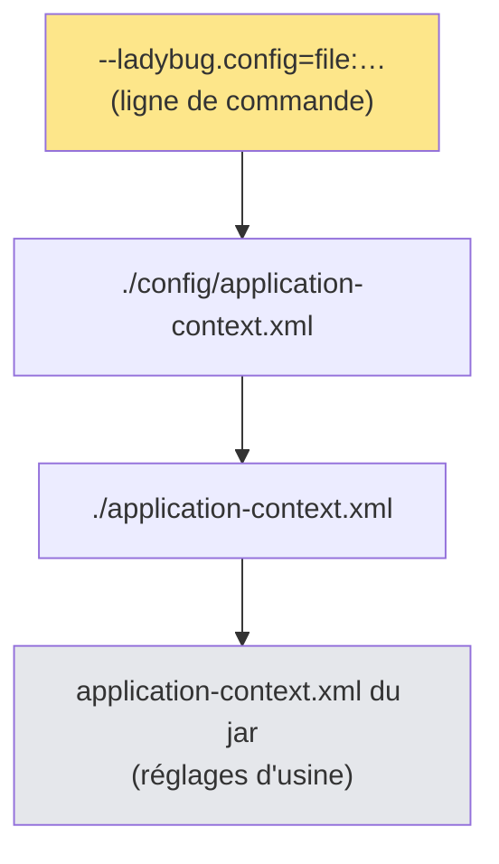

# Configuration externalisée : régler le jeu sans le recompiler

> Principe central de Spring Boot (« Externalized Configuration »), introduit dans Ladybug à l'étape 2 (novembre 2026). Avec, en complément, les **profils** et la **méta-annotation** `@GuiComponent`.

**🟢 L'idée en une image (junior)**

Une voiture sort d'usine avec des réglages par défaut : position du siège, des rétroviseurs, station de radio. Chaque conducteur peut les changer sans rouvrir le moteur, et ses réglages passent avant ceux de l'usine.

Ladybug fonctionne de la même façon. Le jar contient les réglages d'usine (`application-context.xml`, `ladybug.properties`). Un fichier posé à côté du jeu les remplace, et une option sur la ligne de commande passe avant tout le reste. On change les fantômes ou l'apparence sans toucher au code et sans recompiler.

**🔵 Dans Ladybug (confirmé)**

*Avant* : le contexte Spring était créé dans un champ statique, et seulement à partir du XML **du jar**. Un fichier posé à côté du jeu était ignoré (vérifié le 18/11/2026).

```java
public class Application {
    private static final ApplicationContext applicationContext =
        new ClassPathXmlApplicationContext("application-context.xml");   // seulement le jar
    public static void main(String[] args) {
        applicationContext.getBean("mainLadybug", MainLadybug.class).launchTheGame();
    }
}
```

*Après* : Spring Boot démarre le jeu, et chaque réglage a une **chaîne de priorité** claire.

```java
@SpringBootApplication
@ImportResource("${ladybug.config:classpath:application-context.xml}")   // le XML reste la référence (C01)
public class Application {
    public static void main(String[] args) {
        var springXml = ConfigLocations.springXmlLocation(Path.of(""));    // fichier externe s'il existe
        try {
            new SpringApplicationBuilder(Application.class)
                    .headless(false)                           // sinon Swing refuse d'ouvrir la fenêtre
                    .profiles(GuiComponent.PROFILE)            // fenêtre, vues, clavier, son
                    .properties("ladybug.config=" + springXml) // valeur par défaut : la ligne de commande l'emporte
                    .run(args);
        } catch (RuntimeException failure) {
            StartupFailure.reportAndExit(failure, ConfigLocations.effectiveSpringXml(args, springXml));
        }
    }
}
```



Le premier qui existe gagne. Pour `ladybug.properties`, c'est Spring Boot lui-même qui fait le travail, avec une ligne dans [`application.properties`](../../src/main/resources/application.properties#L8) :

```properties
spring.config.import=optional:file:./ladybug.properties,optional:file:./config/ladybug.properties
```

Deux règles complètent le pattern :
- **dire ce qui est utilisé** : au démarrage, [`StartupReport`](../../src/main/java/com/kycox/game/launcher/StartupReport.java#L32) écrit dans les logs le XML et les propriétés réellement chargés ;
- **échouer clairement** (décision C27) : un XML externe invalide n'est pas remplacé en silence par celui du jar. [`StartupFailure`](../../src/main/java/com/kycox/game/launcher/StartupFailure.java#L21) affiche `Cause : java.lang.ClassNotFoundException: com.kycox.game.body.ghost.Clydee`, puis le jeu s'arrête.

*Le complément : profil et méta-annotation.* Pour charger le contexte dans un test, sans écran (test 3.3), il fallait que les 21 classes d'interface ne soient pas créées. Elles portent désormais [`@GuiComponent`](../../src/main/java/com/kycox/game/launcher/GuiComponent.java#L28), qui regroupe deux annotations sous un nom parlant :

```java
@Component
@Profile("gui")                       // créé seulement si le profil « gui » est actif
public @interface GuiComponent { String PROFILE = "gui"; }

@GuiComponent                         // avant : @Component
public class MainFrame extends JFrame { … }
```

Le lanceur active le profil ; un test ne l'active pas, et obtient le modèle seul ([`SpringContextTest`](../../src/test/java/com/kycox/game/launcher/SpringContextTest.java#L22) : 4 fantômes, aucune fenêtre, 0,9 s).

Où le trouver dans le code :
- [`Application`](../../src/main/java/com/kycox/game/Application.java#L39)
- [`ConfigLocations.findExternal()`](../../src/main/java/com/kycox/game/launcher/ConfigLocations.java#L38) et [`springXmlLocation()`](../../src/main/java/com/kycox/game/launcher/ConfigLocations.java#L51)
- [`StartupReport`](../../src/main/java/com/kycox/game/launcher/StartupReport.java#L32), [`StartupFailure`](../../src/main/java/com/kycox/game/launcher/StartupFailure.java#L21)
- [`GuiComponent`](../../src/main/java/com/kycox/game/launcher/GuiComponent.java#L28)
- Le mode d'emploi pour les joueurs : section « Personnaliser le jeu » du [README](../../README.md).

**🟣 Le recul (senior / vétéran)**

- *Principe* : séparer ce qui change selon l'endroit où l'on joue (le réglage) de ce qui ne change pas (le code). C'est le facteur III des « Twelve-Factor Apps » : la configuration hors du code.
- *Pourquoi garder le XML* : `@Configuration` en Java serait plus moderne, mais il faudrait recompiler pour ajouter un fantôme. Le XML externe est un choix voulu par Frédéric (C01). Spring Boot sait mélanger les deux sans difficulté (`@ImportResource`).
- *Convention plutôt que configuration* : les fichiers externes sont cherchés là où Spring Boot cherche les siens, le dossier courant et `config/` (C29). Un développeur qui connaît Spring Boot n'a rien à apprendre.
- *Profils* : un profil sert à décrire **ce qu'on assemble** (avec ou sans interface), pas à multiplier les variantes de réglages (« dev », « prod »…), qui relèvent plutôt des fichiers de propriétés. Ici, il prépare aussi le réseau (étape 9) : un hôte pourra tourner sans fenêtre.
- *Pièges* :
  - **`java.awt.headless`** : Spring Boot passe la JVM en mode « sans écran » par défaut. Pour une application Swing, il faut `headless(false)`. C'est sans doute ce qui avait fait échouer le premier essai avec `SpringApplication.run`, resté commenté dans le code ;
  - **un fichier par défaut silencieux** : si une configuration externe est fausse, revenir en douce à celle du jar trompe l'utilisateur. Mieux vaut échouer avec un message clair ;
  - **les chemins** : `--ladybug.config` attend une URL de ressource Spring. Il faut `file:` pour un fichier, sinon le chemin est cherché dans le jar ;
  - **le format des logs** : Spring Boot impose le sien. `logging.pattern.console` a gardé l'ancien format, pour pouvoir comparer les logs avec la référence « avant ».

**✏️ Exercice**

Créez un `config/ladybug.properties` qui enlève le chapeau des fantômes (`ghosts.hat=0`), puis un `application-context.xml` où Blinky est `CALM` au lieu d'`AGGRESSIVE`. Lancez le jeu et vérifiez, dans les logs, les deux lignes du `StartupReport`. Bonus : écrivez le test qui prouve que le `config/` l'emporte sur le dossier courant pour `ladybug.properties` (indice : `ConfigLocationsTest`).
