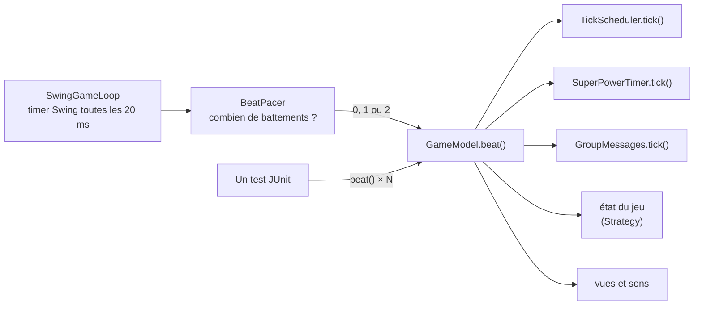

# Game Loop / Update Method : une seule horloge fait avancer tout le jeu

> Source : Robert Nystrom, *Game Programming Patterns*, chapitres « Game Loop » et « Update Method ». Introduit dans Ladybug à l'étape 3.5.1 (novembre 2026) ; la boucle est sortie du modèle à l'étape 4.1.

**🟢 L'idée en une image (junior)**

Un chef d'orchestre bat la mesure, et chaque musicien joue sa partie au rythme de ce battement. Personne ne regarde sa propre montre. Si un musicien comptait le temps de son côté, il finirait par jouer en avance ou en retard sur les autres.

Dans Ladybug, le chef d'orchestre, c'est la boucle du jeu. Elle bat 25 fois par seconde (un battement toutes les 40 ms, la constante `PACE`). À chaque battement, tout ce qui dépend du temps avance d'un pas : les attentes entre deux écrans, le super-pouvoir, les messages « +15 ».

**🔵 Dans Ladybug (confirmé)**

*Avant* : plusieurs objets regardaient « leur montre ». Chacun lançait un `java.util.Timer`, qui tourne dans **son propre fil d'exécution**, et modifiait l'état du jeu quand il voulait, même au milieu d'un battement.

```java
// GameModelGameIsStarting : un fil caché passera le statut à LEVEL_START dans 2,5 s
waitAndDoActionAfterTimer = new WaitAndDoActionAfterTimer();
waitAndDoActionAfterTimer.launch(2500, currentGameStatus, CurrentProgramStatus.TO_LEVEL_START);

// Message : un fil caché par message « +15 » affiché à l'écran
scoreTimer = new IncrementScoreTimer(this);
scoreTimer.launch(1000);
```

Conséquence vue au robot le 19/11/2026 (dette D22) : une touche du clavier et une minuterie changeaient le statut **à la même milliseconde**, et l'ordre `GAME_START` / `LEVEL_START` dépendait du hasard. Impossible, aussi, de rejouer une partie à l'identique dans un test.

*Après* : un seul battement, [`GameModel.beat()`](../../src/main/java/com/kycox/game/engine/model/GameModel.java#L166), qui fait avancer chacun dans un ordre fixe (c'est l'**Update Method** : chaque objet a sa méthode `tick()`).

```java
public void beat() {
    tickScheduler.tick();      // les actions différées arrivées à échéance
    superPowerTimer.tick();    // la peur et le clignotement des fantômes
    groupMessages.tick();      // les messages « +15 » à l'écran
    gameModelManageAction.changeStrategy(manageActionContext.getStrategyStatusAction(currentProgramStatus.getGameStatus()));
    gameModelManageAction.execute();                                   // l'état du jeu joue son battement
    applicationEventPublisher.publishEvent(new EventGameModel(this));  // les vues et les sons sont prévenus
}
```

Les attentes s'expriment en battements, sur le même fil que le reste du jeu :

```java
// GameModelGameIsStarting : 2 500 ms = 63 battements, puis LEVEL_START
tickScheduler.schedule(2500, currentGameStatus::setLevelStart);
```

Et le super-pouvoir n'a plus besoin de deux minuteries en chaîne : il lit son état dans le nombre de battements restants.

```java
public TimerStatus getStatus() {
    if (!countdown.isRunning()) {
        return TimerStatus.STOP;
    }
    return countdown.getRemainingTicks() > FLASH_TICKS ? TimerStatus.RUN : TimerStatus.STOPPING;
}
```



**Étape 4.1 : la boucle sort du modèle.** Jusque-là, le timer Swing et le `BeatPacer` vivaient **dans** `GameModel`. Le modèle dépendait donc de Swing, et les tests devaient l'empêcher de démarrer avec une propriété spéciale (`-Dladybug.loop.autostart=false`). Désormais, le modèle n'expose que `beat()` ; **qui** le fait battre est décidé dehors :

```java
@GuiComponent                       // n'existe qu'avec l'interface : jamais dans les tests
public class SwingGameLoop {
    private final BeatPacer beatPacer = new BeatPacer(PACE, MAX_CATCH_UP);
    private final Timer timer = new Timer(PACE / 2, event -> wakeUp(System.nanoTime()));

    void wakeUp(long nowNanos) {
        for (var i = 0; i < beatPacer.beatsDue(nowNanos); i++) { … gameModel.beat(); }
    }
}
```

Elle démarre dans `MainLadybug.launchTheGame()`, une fois la fenêtre affichée. Bonus : avant, le timer partait pendant la construction du contexte Spring, et ses premiers battements créaient des beans depuis le fil Swing (avertissement « Obtaining singleton bean … while other thread holds singleton lock » dans les logs) ; c'est fini. Demain, un hôte réseau sans fenêtre aura sa propre boucle, sans toucher au modèle.

**Le piège qu'on a rencontré : le pas fixe.** Le timer Swing ne se réveille pas exactement toutes les 40 ms ; sur le Mac de Frédéric, c'était plutôt 43 ms. Comptées en battements, les attentes duraient donc 7 % de trop, et la musique du début de niveau (4,2 s) finissait avant la fin de l'attente, puis repartait. Frédéric l'a entendue deux fois. La correction est le cœur du pattern Game Loop : la boucle **rattrape son retard**. [`BeatPacer`](../../src/main/java/com/kycox/game/tools/timer/BeatPacer.java#L39) regarde l'heure réelle et dit combien de battements jouer (en général 0 ou 1, parfois 2), pour que le jeu avance de 25 battements par seconde, quelle que soit la machine.

Où le trouver dans le code :
- [`GameModel.beat()`](../../src/main/java/com/kycox/game/engine/model/GameModel.java#L166) et [`SwingGameLoop`](../../src/main/java/com/kycox/game/engine/loop/SwingGameLoop.java) (étape 4.1)
- [`BeatPacer.beatsDue()`](../../src/main/java/com/kycox/game/tools/timer/BeatPacer.java#L39)
- [`TickScheduler`](../../src/main/java/com/kycox/game/tools/timer/TickScheduler.java#L40) et [`TickCountdown`](../../src/main/java/com/kycox/game/tools/timer/TickCountdown.java)
- [`SuperPowerTimer`](../../src/main/java/com/kycox/game/tools/timer/SuperPowerTimer.java#L62)
- [`LadybugDying.isEnd()`](../../src/main/java/com/kycox/game/body/ladybug/LadybugDying.java#L39) : Frédéric comptait déjà l'agonie de Ladybug en battements, bien avant ce refactoring.

**🟣 Le recul (senior / vétéran)**

- *Principe* : une seule source de vérité pour le temps. C'est aussi ce qui rend le jeu **déterministe** : avec la même graine de hasard (`GameRandom`) et les mêmes touches au même battement, la partie se rejoue à l'identique. C'est la condition du golden master (étape 3.5.2) et du mode réseau (étape 9), où l'hôte fait autorité battement par battement.
- *Concurrence* : en Swing, tout ce qui touche à l'état doit passer par le fil Swing (l'EDT). Le `javax.swing.Timer` s'y exécute déjà ; un `java.util.Timer`, non. Remplacer des minuteries par des battements supprime toute une classe de bogues sans écrire un seul `synchronized`.
- *Pas fixe ou pas variable* : un jeu peut aussi passer à `update()` le temps écoulé (`deltaTime`). C'est plus souple pour la physique, mais les résultats dépendent alors de la machine et ne se rejouent plus à l'identique. Pour Ladybug (déplacements case par case, réseau prévu), le pas fixe est le bon choix.
- *Quand ne pas l'utiliser* : pour ce qui ne dépend pas des règles du jeu (une animation de l'interface, le défilement d'un bandeau), un timer d'affichage suffit. C'est pourquoi `SimpleTimer` et les `TimerView` sont restés côté vues (ils seront revus à l'étape 4).
- *Pièges* :
  - convertir des millisecondes en battements : arrondir **au-dessus** (2 500 ms → 63 battements), sinon une attente finit avant le son qu'elle accompagne ;
  - ne pas tout rattraper après une longue pause (mise en veille) : `BeatPacer` plafonne à 5 battements, sinon le jeu ferait un bond ;
  - garder un ordre fixe dans `beat()` : l'ordre fait partie des règles du jeu.
- *Choix de comportement à connaître* : comme avant, les attentes et le super-pouvoir continuent de s'écouler pendant la pause. Le corriger est possible en un endroit (ne pas appeler les `tick()` en pause), mais c'est un changement de règle, à décider à part.

**✏️ Exercice**

Le bandeau du bas (`PageEndView`) change de message toutes les 800 ms avec un `SimpleTimer`, dans un autre fil. Proposez une version en battements : qui devrait compter, et qui devrait appeler son `tick()` ? (Indice : les vues reçoivent déjà un `EventGameModel` à chaque battement.)
