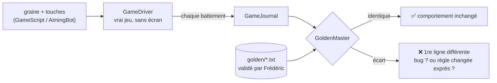

# Golden master : figer le comportement d'aujourd'hui pour oser changer le code demain

> Technique de test de Michael Feathers (*Working Effectively with Legacy Code*), aussi appelée « test de caractérisation » ou « approval testing ». Introduite dans Ladybug à l'étape 3.5.2 (novembre 2026), sur l'idée de Frédéric (doc « Stratégie de tests autonomes »).

**🟢 L'idée en une image (junior)**

Avant de rénover une maison ancienne, on la photographie pièce par pièce. Après les travaux, on compare : tout ce qui a bougé sans qu'on l'ait voulu saute aux yeux. On ne se demande pas si la maison d'origine était parfaite ; on veut seulement savoir ce qui a changé.

Dans Ladybug, la « photo », c'est le **journal d'une partie** : ce qui se passe, battement par battement. On joue une partie, toujours la même, et on compare son journal à celui de référence.

**🔵 Dans Ladybug (confirmé)**

*Avant* : pour vérifier qu'un refactoring ne cassait rien, il fallait lancer le jeu, jouer, regarder, écouter. Le robot aidait, mais il joue à l'aveugle et ne voit que les changements de statut.

*Après* : quatre pièces dans `src/test/java/com/kycox/game/testutil/`, qui s'appuient sur l'horloge unique et le hasard à graine de 3.5.1 :

1. **`GameDriver`** : le vrai jeu, sans écran, piloté battement par battement.
```java
try (var game = GameDriver.start(42, saveDirectory)) {   // graine 42
    game.keys().startGame();                             // comme la touche S
    game.beats(30);                                      // 30 battements = 1,2 s de jeu
}
```
2. **`GameJournal`** : il observe le modèle après chaque battement et note ce qui change.
```
b0241 STATUS IN_GAME
b0722 GHOST Clyde SCARED        ← méga-gomme
b0761 GHOST Clyde DYING         ← Clyde mangé
b0750 STATE ladybug=(6,4) NORMAL | Clyde=(7,2) SCARED | …   ← positions, chaque seconde
```
3. **`GameScript`** et **`AimingBot`** : des touches écrites à l'avance, ou un bot qui vise (fuir, chasser, manger la gomme la plus proche), sans aucun hasard.
4. **`GoldenMaster`** : la comparaison avec la référence de `src/test/resources/golden/`.
```java
GoldenMaster.assertMatches("bot-seed42", game.journal().text());
```
En cas d'écart :
```
Golden master 'bot-seed42' differs from its reference.
First difference at line 87:
    b0722 GHOST Inky SCARED
    b0722 GHOST Pinky SCARED
  - expected: b0761 GHOST Clyde DYING
  + actual:   b0763 GHOST Clyde DYING
```



Trois références, validées une à une par Frédéric (décision C32) :

| Référence | Partie | Ce qu'elle couvre |
|---|---|---|
| `solo-seed42` | touches écrites, 2 min | écrans et durées, déplacements, hasard des fantômes, morts, fin de partie |
| `two-players-seed42` | idem, mode 2 joueurs | fantôme humain (Pinky), touches ZQSD |
| `bot-seed42` | bot qui vise, jusqu'au niveau 2 | méga-gommes, fantômes mangés et régénérés, fruits, téléportations, vie gagnée, fin de niveau |

Pendant la partie du bot, [`GameRules`](../../src/test/java/com/kycox/game/testutil/GameRules.java) vérifie aussi des règles à chaque battement : score jamais en baisse, jamais dans un mur, jamais 60 s sans progrès.

Le tout prend environ 4 secondes dans `mvn verify`, à chaque PR.

**🟣 Le recul (senior / vétéran)**

- *Ce qu'on fige* : le comportement **actuel**, défauts compris. Le golden master ne dit pas si le jeu est juste ; il dit s'il a **changé**. C'est exactement ce qu'il faut avant un gros refactoring (étape 4).
- *Les conditions* : un golden master n'a de sens que si le programme est **déterministe**. D'où 3.5.1 (horloge unique, hasard à graine) et [`DeterminismTest`](../../src/test/java/com/kycox/game/testutil/DeterminismTest.java), vérifié par sabotage (un hasard sans graine fait échouer le test).
- *Changer une règle exprès* : le test échoue, c'est normal. On relit l'écart, puis `mvn test -Dgolden.update=true` réécrit les références ; le diff des fichiers `golden/*.txt` dans la PR montre ce qui a changé dans le jeu.
- *Quand ne pas l'utiliser* : pour une règle précise (« un fantôme mangé rapporte 15 points »), un test unitaire est plus clair et dit **pourquoi** il échoue. Le golden master complète les tests unitaires, il ne les remplace pas.
- *Pièges* :
  - **trop de détail** rend la référence fragile : un journal battement par battement casserait au moindre changement d'ordre. D'où le choix d'événements, plus une ligne d'état par seconde (C31) ;
  - **un état partagé** fausse les parties suivantes : le « fantôme joué par un humain » vit dans une énumération (`GhostsBodyImages`), remise à zéro par `GameDriver` ;
  - **une sauvegarde réelle** : sans `ladybug.save.dir`, les tests auraient écrasé le dernier niveau atteint par le joueur ;
  - **mettre à jour sans relire** : `-Dgolden.update=true` accepte n'importe quel comportement. Une référence se relit toujours avant d'être commitée.

**✏️ Exercice**

Changez la valeur d'un fantôme mangé (`SCORE_EATEN_GHOST`) de 15 à 20, lancez `mvn test` : quelles références échouent, et à quelle ligne ? Remettez 15. Bonus : écrivez un `GameScript` qui fait manger une méga-gomme à Ladybug dès le début (indice : regardez dans `bot-seed42.txt` où était Ladybug au battement 722).
